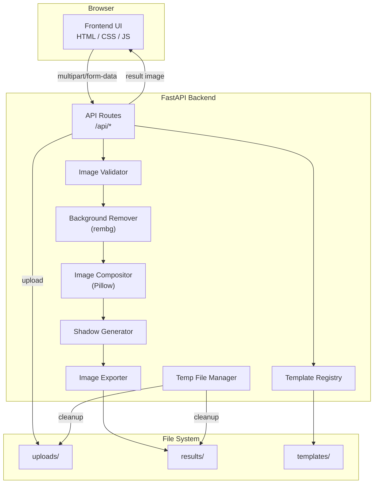

# Product Image Studio

> A premium, web-based tool that helps small online shops create professional e-commerce product images — no expensive camera, studio, or design skills required.

---

## Table of Contents

1. [Project Overview](#1-project-overview)
2. [Problem Statement & Intended Users](#2-problem-statement--intended-users)
3. [MVP Features](#3-mvp-features)
4. [User Workflow](#4-user-workflow)
5. [Technology Stack](#5-technology-stack)
6. [System Architecture](#6-system-architecture)
7. [Image-Processing Pipeline](#7-image-processing-pipeline)
8. [Folder & File Structure](#8-folder--file-structure)
9. [Module Responsibilities](#9-module-responsibilities)
10. [API Contract](#10-api-contract)
11. [Image Validation & Processing Rules](#11-image-validation--processing-rules)
12. [Background Template Design System](#12-background-template-design-system)
13. [Temporary File Lifecycle](#13-temporary-file-lifecycle)
14. [Error-Handling Strategy](#14-error-handling-strategy)
15. [Security Considerations](#15-security-considerations)
16. [Installation & Local Development (Windows)](#16-installation--local-development-windows)
17. [Testing Plan](#17-testing-plan)
18. [Known Limitations & Troubleshooting](#18-known-limitations--troubleshooting)
19. [Future SaaS Roadmap](#19-future-saas-roadmap)
20. [Progress Checklist](#20-progress-checklist)

---

## 1. Project Overview

Product Image Studio is an MVP web application that allows a user to:

1. Upload a product photograph taken on any background.
2. Automatically remove the background using an on-device AI model.
3. Composite the product onto a professionally designed preset background.
4. Adjust scale, position, and shadow to taste.
5. Preview and download the final image as PNG or JPEG.

The visual quality is inspired by premium e-commerce listings (e.g., UGREEN-style product pages). The application does **not** copy any third-party branding, assets, or exact design.

This is the first milestone of a future SaaS product. It prioritises **image quality**, **product accuracy**, **simplicity**, and **maintainability**.

---

## 2. Problem Statement & Intended Users

### Problem

Small online sellers (Etsy, Shopify, Amazon third-party) often photograph products on cluttered desks or uneven backgrounds. Professional retouching is expensive and slow. Existing free tools produce inconsistent results or require design expertise.

### Intended Users

| Persona | Need |
|---|---|
| Solo Etsy seller | Clean white-background listing images, fast turnaround |
| Small Shopify store owner | Consistent look across a product catalog |
| Social-media reseller | Quick, professional-looking images for Instagram/Facebook |
| Product photographer (hobbyist) | Rapid background swap without Photoshop |

---

## 3. MVP Features

### Included

- Single-image upload (drag-and-drop + file picker).
- Client-side file validation (type, size).
- Server-side file validation (magic bytes, dimensions, pixel count).
- AI background removal via **rembg** (CPU, local model).
- Three preset studio background templates rendered with Pillow.
- Adjustable product scale, horizontal/vertical position, shadow intensity, and shadow softness.
- Real-time preview of the composited result.
- Before/after comparison (side-by-side).
- Download as PNG (lossless) or JPEG (optimised).
- Temporary file management with automatic expiration cleanup.
- Responsive layout (desktop, tablet, mobile).
- Automated backend tests (unit + integration).

### Explicitly Excluded (Future)

- User accounts / authentication.
- Database / product catalogues.
- Batch processing.
- Cloud storage.
- Subscription billing.
- Custom / AI-generated backgrounds.
- E-commerce platform integrations.
- Production deployment tooling.

---

## 4. User Workflow

```
┌─────────────┐    ┌─────────────────┐    ┌───────────────────┐
│  1. Upload   │───▶│ 2. Choose       │───▶│ 3. Adjust         │
│  product     │    │ background      │    │ scale, position,  │
│  photo       │    │ template        │    │ shadow            │
└─────────────┘    └─────────────────┘    └───────────────────┘
                                                   │
                                                   ▼
┌─────────────┐    ┌─────────────────┐    ┌───────────────────┐
│  6. Start    │◀──│ 5. Download     │◀──│ 4. Preview        │
│  new image   │    │ PNG / JPEG      │    │ result & compare  │
└─────────────┘    └─────────────────┘    └───────────────────┘
```

---

## 5. Technology Stack

| Layer | Technology | Reason |
|---|---|---|
| Frontend markup | HTML5 | Semantic, accessible, no build step |
| Frontend style | CSS3 (vanilla) | Full control, no framework overhead |
| Frontend logic | Vanilla JavaScript (ES modules) | No bundler required, maintainable |
| Backend framework | FastAPI (Python) | Async-ready, auto-generated OpenAPI docs, fast |
| ASGI server | Uvicorn | Production-quality server for FastAPI |
| Image processing | Pillow (PIL Fork) | Industry-standard Python imaging library |
| Background removal | rembg + ONNX Runtime | Best open-source background removal, runs on CPU |
| File uploads | python-multipart | Required by FastAPI for multipart/form-data |
| Testing | pytest + httpx | Standard Python testing with async support |

---

## 6. System Architecture



---

## 7. Image-Processing Pipeline


### Processing Details

| Step | Detail |
|---|---|
| Load & Validate | Verify magic bytes, reject corrupt/oversized images |
| EXIF Orientation | Auto-rotate based on EXIF tag 0x0112 |
| Background Removal | rembg `remove()` → RGBA output |
| Bounding Box | Find non-transparent pixel bounds from alpha channel |
| Crop | Remove excess transparent margins |
| Resize | Fit product into composition zone (≈80% of canvas), maintain aspect ratio, high-quality `LANCZOS` resampling |
| Background | Render selected template at 1200×1200 px |
| Shadow | Gaussian-blurred, offset alpha mask with configurable intensity/softness |
| Composite Shadow | Paste shadow layer behind product |
| Composite Product | Paste original-pixel foreground on top |
| Export | PNG (lossless) or JPEG (quality 92, no alpha) |

---

## 8. Folder & File Structure

```
Image Studio/
├── README.md                          # This file
├── requirements.txt                   # Python dependencies
├── .env.example                       # Environment variable template
│
├── frontend/
│   ├── index.html                     # Main application page
│   ├── css/
│   │   └── styles.css                 # Complete stylesheet
│   ├── js/
│   │   ├── app.js                     # Application controller
│   │   ├── api.js                     # Backend API service
│   │   ├── upload.js                  # Upload & drag-drop logic
│   │   ├── templates.js               # Template selector logic
│   │   ├── controls.js                # Adjustment controls logic
│   │   ├── preview.js                 # Image preview & comparison
│   │   └── utils.js                   # Shared utilities
│   └── assets/
│       └── icons/                     # SVG icons (inline)
│
├── backend/
│   ├── main.py                        # FastAPI application entry point
│   ├── config.py                      # Configuration & environment
│   ├── routes/
│   │   ├── __init__.py
│   │   ├── health.py                  # GET /api/health
│   │   ├── templates.py               # GET /api/templates
│   │   ├── process.py                 # POST /api/process
│   │   └── results.py                 # GET /api/results/*
│   ├── services/
│   │   ├── __init__.py
│   │   ├── validator.py               # Image validation service
│   │   ├── remover.py                 # Background removal service
│   │   ├── compositor.py              # Image composition service
│   │   ├── shadow.py                  # Shadow generation
│   │   ├── exporter.py                # Image export (PNG/JPEG)
│   │   └── templates.py               # Template registry & rendering
│   ├── utils/
│   │   ├── __init__.py
│   │   ├── temp_manager.py            # Temporary file lifecycle
│   │   └── identifiers.py            # Secure ID generation
│   └── data/
│       ├── uploads/                   # Temporary uploaded files
│       ├── results/                   # Processed output files
│       └── templates/                 # Template preview thumbnails
│
└── tests/
    ├── __init__.py
    ├── conftest.py                    # Shared fixtures
    ├── test_health.py
    ├── test_templates.py
    ├── test_validation.py
    ├── test_process.py
    ├── test_results.py
    ├── test_compositor.py
    └── assets/                        # Synthetic test images
        ├── valid_jpeg.jpg
        ├── valid_png.png
        ├── valid_webp.webp
        ├── corrupt.jpg
        ├── fake_extension.jpg         # Actually a text file
        └── oversized.png
```

---

## 9. Module Responsibilities

### Frontend Modules

| File | Responsibility |
|---|---|
| `index.html` | Semantic page structure, all screens |
| `styles.css` | Design system: tokens, layout, components, states, responsive |
| `app.js` | Application lifecycle, screen transitions, state management |
| `api.js` | All `fetch()` calls to backend, error normalisation |
| `upload.js` | Drag-and-drop, file picker, client-side validation, preview |
| `templates.js` | Fetch templates, render selector, track selection |
| `controls.js` | Range sliders for scale/position/shadow, value display |
| `preview.js` | Result display, before/after comparison, download triggers |
| `utils.js` | DOM helpers, object URL management, formatting |

### Backend Modules

| File | Responsibility |
|---|---|
| `main.py` | FastAPI app, CORS, lifespan (model init, cleanup scheduler) |
| `config.py` | Env-based settings, file size limits, paths |
| `routes/health.py` | Health check endpoint |
| `routes/templates.py` | Template listing endpoint |
| `routes/process.py` | Upload + process endpoint |
| `routes/results.py` | Preview / download / metadata endpoints |
| `services/validator.py` | Magic-byte check, dimension check, EXIF handling |
| `services/remover.py` | rembg session management, background removal |
| `services/compositor.py` | Full composition pipeline orchestration |
| `services/shadow.py` | Shadow mask generation |
| `services/exporter.py` | PNG / JPEG export with correct settings |
| `services/templates.py` | Template registry, background rendering |
| `utils/temp_manager.py` | Result storage, expiration cleanup |
| `utils/identifiers.py` | Cryptographic ID generation |

---

## 10. API Contract

### `GET /api/health`

**Response** `200 OK`

```json
{
  "status": "healthy",
  "model_loaded": true,
  "version": "1.0.0"
}
```

### `GET /api/templates`

**Response** `200 OK`

```json
{
  "templates": [
    {
      "id": "premium_light",
      "name": "Premium Light Studio",
      "description": "Clean white-to-light-gray gradient. Ideal for most products.",
      "preview_url": "/api/templates/premium_light/preview",
      "defaults": {
        "scale": 80,
        "position_x": 50,
        "position_y": 50,
        "shadow_intensity": 40,
        "shadow_softness": 30
      }
    }
  ]
}
```

### `POST /api/process`

**Request**: `multipart/form-data`

| Field | Type | Required | Description |
|---|---|---|---|
| `image` | file | yes | Product image (JPEG, PNG, WebP) |
| `template_id` | string | yes | Background template ID |
| `scale` | integer | no | Product scale 10–200 (default 80) |
| `position_x` | integer | no | Horizontal position 0–100 (default 50) |
| `position_y` | integer | no | Vertical position 0–100 (default 50) |
| `shadow_intensity` | integer | no | Shadow opacity 0–100 (default 40) |
| `shadow_softness` | integer | no | Shadow blur 0–100 (default 30) |
| `output_format` | string | no | `png` or `jpeg` (default `png`) |

**Response** `200 OK`

```json
{
  "result_id": "a1b2c3d4e5f6",
  "status": "completed",
  "preview_url": "/api/results/a1b2c3d4e5f6/preview",
  "download_url": "/api/results/a1b2c3d4e5f6/download",
  "original_filename": "product.jpg",
  "original_dimensions": [800, 600],
  "output_dimensions": [1200, 1200],
  "template_id": "premium_light",
  "output_format": "png",
  "created_at": "2026-10-13T12:00:00Z"
}
```

**Error Responses**

| Code | Condition |
|---|---|
| `400` | Invalid file type, corrupt image, missing fields |
| `413` | File too large |
| `422` | Invalid parameter values |
| `500` | Processing failure |
| `503` | Model not loaded |

### `GET /api/results/{result_id}/preview`

Returns the processed image with `Content-Type: image/png` or `image/jpeg`.

**Error**: `404` if result not found or expired.

### `GET /api/results/{result_id}/download`

Returns the image as a downloadable attachment with `Content-Disposition: attachment; filename="product_studio_<id>.<ext>"`.

### `GET /api/templates/{template_id}/preview`

Returns a 400×400 template preview thumbnail.

---

## 11. Image Validation & Processing Rules

### Client-Side (Frontend)

| Rule | Value |
|---|---|
| Accepted extensions | `.jpg`, `.jpeg`, `.png`, `.webp` |
| Max file size | 10 MB |
| Feedback | Immediate inline error message |

### Server-Side (Backend)

| Rule | Value |
|---|---|
| Magic byte verification | JPEG `FF D8 FF`, PNG `89 50 4E 47`, WebP `52 49 46 46…57 45 42 50` |
| Max upload size | 10 MB (configurable via `MAX_UPLOAD_SIZE_MB`) |
| Max pixel dimensions | 8192 × 8192 |
| Max pixel count | 40 megapixels |
| Color mode | Convert to RGB/RGBA as needed |
| EXIF orientation | Auto-rotate, strip EXIF |
| Corrupt file | Attempt `Image.verify()`, reject on failure |

### Adjustment Ranges

| Parameter | Min | Max | Default | Unit |
|---|---|---|---|---|
| `scale` | 10 | 200 | 80 | % of composition zone |
| `position_x` | 0 | 100 | 50 | % left-to-right |
| `position_y` | 0 | 100 | 50 | % top-to-bottom |
| `shadow_intensity` | 0 | 100 | 40 | % opacity |
| `shadow_softness` | 0 | 100 | 30 | blur radius scale |

---

## 12. Background Template Design System

Each template is defined in `backend/services/templates.py` as a dataclass:

```python
@dataclass
class BackgroundTemplate:
    id: str
    name: str
    description: str
    render: Callable[[int, int], Image.Image]  # (width, height) → PIL Image
    defaults: dict  # Default adjustment values
```

### Initial Templates

| ID | Name | Background |
|---|---|---|
| `premium_light` | Premium Light Studio | White → very light gray radial gradient, subtle vignette |
| `soft_gray` | Soft Gray Studio | Warm light gray, gentle directional lighting effect |
| `warm_neutral` | Warm Neutral Studio | Warm beige/cream tone, soft warm gradient |

All backgrounds are rendered programmatically with Pillow at 1200×1200. No external image dependencies.

### Adding a New Template

1. Add a render function to `backend/services/templates.py`.
2. Register it in the `TEMPLATE_REGISTRY` dictionary.
3. The frontend automatically picks it up from `GET /api/templates`.

---

## 13. Temporary File Lifecycle

```
Upload Request
    │
    ▼
uploads/<uuid>_original.<ext>     ← Saved on upload
    │
    ▼
[Processing in memory]            ← rembg + Pillow (no intermediate disk files)
    │
    ▼
results/<result_id>/
    ├── output.png                ← Final composited image
    └── metadata.json             ← Processing settings & timestamps
    │
    ▼
[Cleanup scheduler]              ← Runs every 10 minutes
    │
    ▼
Delete results older than 1 hour
Delete orphaned uploads older than 30 minutes
```

### Rules

- Original uploads are deleted after processing completes (success or failure).
- Results expire after **1 hour** (configurable via `RESULT_TTL_MINUTES`).
- A background task checks for expired files every **10 minutes**.
- File identifiers are generated with `secrets.token_urlsafe(16)`.
- No user-supplied filenames are used in filesystem paths.

---

## 14. Error-Handling Strategy

### Backend

- All endpoints return JSON error bodies: `{ "error": "<code>", "message": "<human-readable>" }`.
- Validation errors include field-level details.
- Processing failures log the full traceback server-side but return only a safe message to the client.
- Partial/temporary files are cleaned up in `finally` blocks.
- A global exception handler catches unhandled errors and returns `500`.

### Frontend

- API errors are parsed and displayed in context (upload area, processing area, etc.).
- Network failures show a connection error with retry suggestion.
- File validation errors appear immediately before upload.
- Processing errors offer a "Try Again" action.
- The UI never shows raw stack traces or technical error codes to the user.

---

## 15. Security Considerations

| Concern | Mitigation |
|---|---|
| Arbitrary file upload | Magic-byte validation, extension check, size limit, dimension limit |
| Decompression bomb | Max pixel count (40MP), `PIL.Image.MAX_IMAGE_PIXELS` set |
| Path traversal | Server-generated UUIDs for all filenames; user filenames never used in paths |
| Unrestricted file access | Unguessable `secrets.token_urlsafe` result IDs |
| CORS | Restricted to `http://localhost:*` and `http://127.0.0.1:*` during development |
| Sensitive data in logs | Image contents never logged; only metadata |
| Resource exhaustion | Configurable max concurrent processing (semaphore) |
| Temp file leaks | Expiration-based cleanup + failure cleanup |

> **Note:** Unguessable IDs provide adequate access control for local single-user development. Production multi-user deployment requires proper authentication and authorization — documented in the Future Roadmap.

---

## 16. Installation & Local Development (Windows)

### Prerequisites

- **Python 3.10 or 3.11** (3.11 recommended for performance; verify rembg/onnxruntime compatibility)
- **Node.js** is **not** required (vanilla frontend)
- **Git** (optional, for version control)

### Setup

```powershell
# 1. Clone or navigate to the project directory
cd "E:\Image Studio"

# 2. Create a Python virtual environment
python -m venv venv

# 3. Activate the virtual environment
.\venv\Scripts\Activate.ps1

# 4. Install Python dependencies
pip install -r requirements.txt

# 5. Copy environment configuration (optional)
copy .env.example .env
```

### Running the Application

```powershell
# Terminal 1 — Start the backend (from project root)
.\venv\Scripts\Activate.ps1
uvicorn backend.main:app --reload --host 127.0.0.1 --port 8000

# Terminal 2 — Serve the frontend (from project root)
python -m http.server 3000 --directory frontend
```

### Verification

| Check | URL |
|---|---|
| Frontend | http://localhost:3000 |
| API Health | http://localhost:8000/api/health |
| API Docs (Swagger) | http://localhost:8000/docs |
| API Docs (ReDoc) | http://localhost:8000/redoc |

### First Run

On first launch, **rembg** will automatically download the U2Net model (~176 MB). This is a one-time download. Expect the first processing request to take longer as the model initializes.

### Running Tests

```powershell
.\venv\Scripts\Activate.ps1
pytest tests/ -v
```

### Environment Variables

| Variable | Default | Description |
|---|---|---|
| `MAX_UPLOAD_SIZE_MB` | `10` | Maximum upload file size in MB |
| `RESULT_TTL_MINUTES` | `60` | Minutes before results are cleaned up |
| `CLEANUP_INTERVAL_MINUTES` | `10` | Cleanup scheduler interval |
| `MAX_CONCURRENT_PROCESSING` | `2` | Max simultaneous image processing tasks |
| `CANVAS_SIZE` | `1200` | Output canvas dimensions (square) |
| `FRONTEND_ORIGIN` | `http://localhost:3000` | Allowed CORS origin |

---

## 17. Testing Plan

### Unit Tests (mocked rembg)

| Test | Description |
|---|---|
| `test_health.py` | Health endpoint returns status and model state |
| `test_templates.py` | Template list returns all registered templates with correct schema |
| `test_validation.py` | Valid JPEG/PNG/WebP accepted; invalid extension, spoofed MIME, corrupt, oversized, excessive dimensions rejected |
| `test_compositor.py` | Output is 1200×1200, product aspect ratio preserved, product within canvas |

### Integration Tests (real rembg model)

| Test | Description |
|---|---|
| `test_process.py` | Full upload → process → preview → download workflow |
| `test_results.py` | Result retrieval, download headers, 404 for missing/expired |

### Frontend Tests (manual checklist)

- [ ] Drag-and-drop upload works
- [ ] File picker upload works
- [ ] Invalid file type rejected with message
- [ ] Oversized file rejected with message
- [ ] Image preview displays correctly
- [ ] Template selector loads and highlights selection
- [ ] All sliders update values in real-time
- [ ] Process button submits to backend
- [ ] Processing state shown during request
- [ ] Result image displays
- [ ] Before/after comparison works
- [ ] PNG download works
- [ ] JPEG download works
- [ ] Reset/new image clears state
- [ ] Responsive layout on mobile width
- [ ] No console errors

### Acceptance Criteria

1. Upload a real product photo → background removed → composited on each of 3 templates → downloaded.
2. Invalid files rejected with clear errors.
3. Processing failures handled gracefully.
4. Temporary files cleaned up.
5. All automated tests pass.

---

## 18. Known Limitations & Troubleshooting

### Known Limitations

- **CPU-only processing**: Background removal takes 5–30 seconds depending on image size and CPU. GPU acceleration available with `onnxruntime-gpu` but not required.
- **Single-user**: No authentication or session isolation. Designed for local use.
- **No batch processing**: One image at a time.
- **Model quality**: rembg/U2Net works well for most product photos but may struggle with transparent objects, fine hair, or products that blend with backgrounds.
- **No undo/history**: Each processing request is independent.

### Troubleshooting

| Issue | Solution |
|---|---|
| `ModuleNotFoundError: rembg` | Ensure virtual environment is activated: `.\venv\Scripts\Activate.ps1` |
| Model download fails | Check internet connection. Model is cached in `~/.u2net/`. Download manually if needed. |
| `onnxruntime` import error | Ensure Python version is compatible. Try `pip install onnxruntime==1.16.3` |
| CORS errors in browser | Ensure backend runs on port 8000 and frontend on port 3000 |
| Port already in use | Change port: `uvicorn backend.main:app --port 8001` |
| Image processing very slow | Normal on CPU. Reduce input image size. Consider `onnxruntime-gpu` if NVIDIA GPU available. |
| Out of memory | Reduce `MAX_CONCURRENT_PROCESSING` to 1. Reduce max image dimensions. |
| Temporary files not cleaned | Restart backend to trigger cleanup. Check `RESULT_TTL_MINUTES`. |

---

## 19. Future SaaS Roadmap

> **Do not implement these in the MVP.**

| Phase | Feature |
|---|---|
| 2.0 | User registration & authentication (OAuth2 / email) |
| 2.1 | PostgreSQL database, product catalogues |
| 2.2 | Multi-tenant shop accounts |
| 3.0 | Subscription plans & usage credits (Stripe) |
| 3.1 | Cloud object storage (S3 / GCS) |
| 3.2 | Background job queue (Celery / ARQ) |
| 4.0 | Batch image processing |
| 4.1 | Additional & custom templates |
| 4.2 | AI-generated backgrounds (Stable Diffusion / DALL-E) |
| 5.0 | E-commerce integrations (Shopify, Etsy, WooCommerce APIs) |
| 5.1 | Production deployment (Docker, CI/CD, monitoring) |
| 5.2 | CDN & edge caching for processed images |

---

## 20. Progress Checklist

| # | Module | Status |
|---|---|---|
| 0 | README.md — Project roadmap & documentation | ✅ Completed |
| 1 | Frontend — HTML structure | ✅ Completed |
| 2 | Frontend — CSS design system | ✅ Completed |
| 3 | Frontend — JavaScript modules | ✅ Completed |
| 4 | Frontend — Local testing & polish | ✅ Completed |
| 5 | Backend — FastAPI foundation & config | ✅ Completed |
| 6 | Backend — API routes | ✅ Completed |
| 7 | Backend — Image validation service | ✅ Completed |
| 8 | Backend — Background removal service | ✅ Completed |
| 9 | Backend — Composition & shadow pipeline | ✅ Completed |
| 10 | Backend — Template system | ✅ Completed |
| 11 | Backend — Export & download | ✅ Completed |
| 12 | Backend — Temp file management | ✅ Completed |
| 13 | Integration — Frontend ↔ Backend connection | ✅ Completed |
| 14 | Security — Validation, CORS, cleanup | ✅ Completed |
| 15 | Testing — Unit tests | ✅ Completed |
| 16 | Testing — Integration tests | ✅ Completed |
| 17 | Final — End-to-end verification | ✅ Completed |

